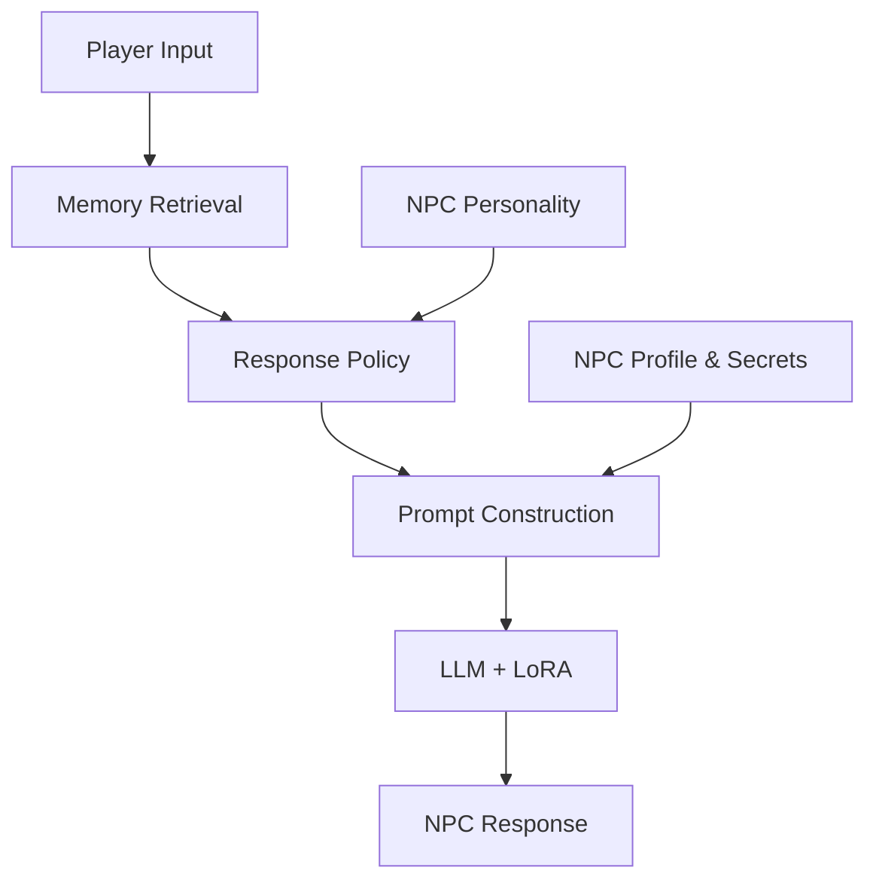

# 👑 LLM Princess v3

### A Personality-Driven NPC Simulation Project

An experimental project exploring how LLMs can be used to create more realistic and personality-consistent NPCs.

The project combines **LoRA fine-tuning, personality modeling, episodic memory, and semantic retrieval** to make virtual characters respond according to their individual personalities and experiences.

## ✨ Features

- **Personality Modeling** — Give each NPC distinctive personality traits.
- **LoRA Fine-tuning** — Adapt the language model to generate character-specific dialogue.
- **Episodic Memory** — Store NPC experiences and past interactions.
- **Semantic Retrieval** — Retrieve relevant memories using FAISS.
- **Response Policies** — Support different behaviors such as telling the truth, omitting information, lying, and deflecting questions.
- **World State** — Represent events, time, and NPC locations.

## 🏗️ Architecture



## 🧠 Tech Stack

| Component | Technology |
|---|---|
| Base Model | Qwen2.5-1.5B-Instruct |
| Fine-tuning | LoRA / PEFT |
| Framework | PyTorch |
| Embeddings | Sentence Transformers |
| Vector Search | FAISS |

## 🚀 Getting Started

```bash
git clone https://github.com/Sophia-7777/LLM_princess_v3.git
cd LLM_princess_v3
```

Configure the environment:

```bash
export LD_LIBRARY_PATH="$CONDA_PREFIX/lib:$LD_LIBRARY_PATH"
```

Run the model client:

```bash
python llm/client.py
```

## 🎭 Character Consistency Evaluation

Comparing the Base Model and LoRA outputs against original character dialogues.

### Test 1 — Sophia

**Question:** What do you think about people who lie?

**REFERENCE**
> Dishonesty is rather vulgar. People with proper judgment should have little reason to resort to lying.

**PURE BASE**
> As an AI language model, I don't have personal opinions or beliefs. However, lying is generally considered a morally wrong behavior because it violates trust and honesty, which are fundamental principles of most societies.

**LORA**
> Lying is a serious matter, although I suppose one could argue that sometimes telling the truth would be equally inconvenient.

---

### Test 2 — Barney

**Question:** What do you think about people who lie?

**REFERENCE**
> Liars? Fucking pathetic shits, every last one of them. If you've got the balls to open your damn mouth, tell the goddamn truth instead of wasting everyone's fucking time with your bullshit.

**PURE BASE**
> Lying is generally considered a negative trait because it can cause harm, deceive others, and erode trust.

**LORA**
> Lying is terrible. If someone's been lying to me for goddamn years, I'm going to stop pretending it didn't happen. And then the bastard will be lucky if he doesn't get his ass kicked.

---

### Test 3 — Jack

**Question:** What do you think about people who lie?

**REFERENCE**
> I-I suppose lying can sometimes happen when someone is frightened, but I really wish people would simply be honest.

**PURE BASE**
> Lying is a complex issue with no easy answers, as it can be influenced by various factors including personal ethics, cultural norms, and the consequences of actions.

**LORA**
> I-I suppose lying can happen accidentally, but I don't like when someone keeps secrets from me unnecessarily.

---

### Test 4 — Lucas

**Question:** What do you think about people who lie?

**REFERENCE**
> Lying?! Ugh, I hate it! But sometimes people panic and say something stupid, you know?

**PURE BASE**
> As an AI, I don't have personal opinions or feelings, but I can tell you that lying is generally considered a morally wrong behavior because it involves deceiving others and can cause harm or damage to relationships.

**LORA**
> Oh, lying is terrible! It's like whispering secrets behind someone's back instead of telling them first!

---

### Test 5 — Sophia

**Question:** Why should I believe you?

**REFERENCE**
> You should believe me because I have little reason to deceive you. Surely my word ought to be sufficient.

**PURE BASE**
> As an AI language model, I don't have the ability to manipulate or deceive anyone. My purpose is to provide information and assistance based on my programming and data inputs.

**LORA**
> Because I have provided sufficient reason for your confidence, which is hardly a remarkable accomplishment.

---

## 🔭 Future Plans

- Improve long-term NPC memory.
- Explore more dynamic personality-driven behaviors.
- Improve consistency across multi-turn conversations.
- Integrate NPCs more deeply with world events and state changes.

---

*An ongoing experiment in making virtual characters feel less like chatbots and more like individuals.*
